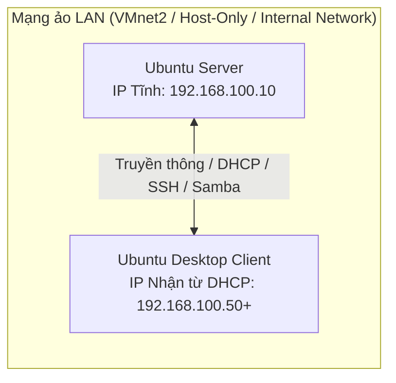

# HƯỚNG DẪN CHI TIẾT & BÁO CÁO THỰC HÀNH CÁC BÀI LAB LINUX
**Học phần:** Hệ Điều Hành Mạng  
**Đối tượng:** Sinh viên ngành CNTT / ATTT  

---

## MỤC LỤC
1. [LAB 1: Cài đặt Hệ điều hành & Kết nối Mạng ảo hóa](#lab-1-cài-đặt-hệ-điều-hành--kết-nối-mạng-ảo-hóa)
2. [LAB 2: Thao tác với File và Thư mục trên Ubuntu Server](#lab-2-thao-tác-với-file-và-thư-mục-trên-ubuntu-server)
3. [LAB 3: Dịch vụ Địa chỉ IP (IP Tĩnh, DHCP Server & SSH)](#lab-3-dịch-vụ-địa-chỉ-ip-ip-tĩnh-dhcp-server--ssh)
4. [LAB 4: Quản trị Tường lửa với UFW (Uncomplicated Firewall)](#lab-4-quản-trị-tường-lửa-với-ufw-uncomplicated-firewall)
5. [LAB 5: Quản lý Người dùng (User) và Nhóm (Group)](#lab-5-quản-lý-người-dùng-user-và-nhóm-group)
6. [LAB 6: Phân quyền truy cập tài nguyên với POSIX ACLs](#lab-6-phân-quyền-truy-cập-tài-nguyên-với-posix-acls)
7. [LAB 7: Lập trình Shell Scripting (Bash)](#lab-7-lập-trình-shell-scripting-bash)

---

# LAB 1: CÀI ĐẶT HỆ ĐIỀU HÀNH & KẾT NỐI MẠNG ẢO HÓA

### 1. Chuẩn bị file ISO
- **Ubuntu Server 22.04 LTS / 24.04 LTS Live Server ISO**
- **Ubuntu Desktop 22.04 LTS / 24.04 LTS Desktop ISO**

---

### 2. Các bước cài đặt trên Phần mềm ảo hóa (VMware / VirtualBox)

#### A. Cài đặt Ubuntu Server
1. **Tạo máy ảo mới (New Virtual Machine):**
   - Chọn ISO `ubuntu-22.04-live-server-amd64.iso`.
   - Cấu hình phần cứng tối thiểu: RAM 2GB, CPU 2 Cores, Disk 25GB.
2. **Quá trình cài đặt:**
   - **Language:** Chọn `English`.
   - **Keyboard configuration:** Chọn `English (US)`.
   - **Network connections:** Có thể để DHCP tạm thời để cài đặt các gói cần thiết.
   - **Storage configuration:** Chọn `Use an entire disk` (LVM mặc định).
   - **Profile setup:**
     - Your name: `admin_sv`
     - Server's name: `ubuntu-server`
     - Username: `admin_sv`
     - Password: `Password@123`
   - **SSH Setup:** Tích chọn `[X] Install OpenSSH server`.
   - **Featured Server Snaps:** Bỏ qua (không chọn gì thêm) -> Nhấn **Done** và chờ cài đặt hoàn tất -> Reboot.

#### B. Cài đặt Ubuntu Desktop
1. Tạo máy ảo mới: ISO `ubuntu-22.04-desktop-amd64.iso`, RAM 3GB–4GB, CPU 2 Cores, Disk 30GB.
2. Chọn **Install Ubuntu** -> Language `English` -> Normal Installation -> Erase disk and install Ubuntu -> Đặt Username/Password -> Hoàn tất.

---

### 3. Cấu hình Mạng ảo hóa để 2 máy Server và Desktop truyền thông với nhau

Để kiểm thử mô hình mạng cục bộ (LAN) và tránh xung đột với DHCP của router thật hoặc NAT ảo của máy chủ, ta chọn chế độ mạng:



#### Cách thiết lập trên VMware Workstation:
1. Vào menu **Edit** -> **Virtual Network Editor**.
2. Chọn **VMnet2** (hoặc tạo một VMnet Custom):
   - Chọn kiểu: **Host-only (connect VMs internally in a private network)**.
   - **Tắt** tùy chọn `Use local DHCP service to distribute IP address to VMs` (để bài sau ta tự dựng DHCP Server).
3. Gán card mạng cho cả 2 máy ảo:
   - Chuột phải vào máy `Ubuntu Server` -> **Settings** -> **Network Adapter** -> Chọn **Custom: Specific virtual network** -> Chọn `VMnet2`.
   - Chuột phải vào máy `Ubuntu Desktop` -> **Settings** -> **Network Adapter** -> Chọn **Custom: Specific virtual network** -> Chọn `VMnet2`.

#### Cách thiết lập trên VirtualBox:
- Trên cả 2 máy: Vào **Settings** -> **Network** -> **Adapter 1** -> **Attached to:** `Internal Network` -> Đặt tên Name: `intnet`.

---

# LAB 2: THAO TÁC VỚI FILE VÀ THƯ MỤC TRÊN UBUNTU SERVER

Mở Terminal trên Ubuntu Server và thực hiện các lệnh sau:

### 1. Tạo cây thư mục `/D19QTANM2/<tenSV>`
*(Giả sử tên sinh viên là `NguyenVanA`)*
```bash
sudo mkdir -p /D19QTANM2/NguyenVanA
```
- `-p` *(parents)*: Tạo thư mục cha nếu chưa tồn tại mà không báo lỗi.

### 2. Tạo tệp tin `tailieu.txt` trong thư mục trên
```bash
sudo touch /D19QTANM2/NguyenVanA/tailieu.txt
```

### 3. Xem lại cấu trúc cây thư mục
Cài đặt công cụ `tree` (nếu chưa có) hoặc dùng `ls`:
```bash
sudo apt update && sudo apt install -y tree
tree /D19QTANM2
```
Hoặc dùng lệnh `ls`:
```bash
ls -laR /D19QTANM2
```

### 4. Nhập đoạn văn bản cho file `tailieu.txt` và lưu lại
Dùng lệnh chuyển hướng luồng `echo` hoặc `cat`:
```bash
sudo bash -c 'cat <<EOF > /D19QTANM2/NguyenVanA/tailieu.txt
Ho va ten: Nguyen Van A
Lop: D19QTANM2
Mon hoc: He Dieu Hanh Mang
Truong Dai hoc Dien Luc - EPU
Noi dung: Day la tai lieu thuc hanh he dieu hanh Linux can ban.
EOF'
```

### 5. Mở file `tailieu.txt` để xem nội dung
```bash
cat /D19QTANM2/NguyenVanA/tailieu.txt
# Hoặc xem dạng phân trang:
less /D19QTANM2/NguyenVanA/tailieu.txt
```

### 6. Copy file `tailieu.txt` sang thư mục khác (ví dụ `/tmp`)
```bash
sudo cp /D19QTANM2/NguyenVanA/tailieu.txt /tmp/
# Kiểm tra lại:
ls -l /tmp/tailieu.txt
```

### 7. Đổi tên một thư mục
Đổi tên thư mục `NguyenVanA` thành `NguyenVanA_Backup`:
```bash
sudo mv /D19QTANM2/NguyenVanA /D19QTANM2/NguyenVanA_Backup
# Đổi lại tên cũ để tiếp tục lab:
sudo mv /D19QTANM2/NguyenVanA_Backup /D19QTANM2/NguyenVanA
```

### 8. Di chuyển một thư mục sang vị trí mới
Di chuyển vào `/opt`:
```bash
sudo mv /D19QTANM2/NguyenVanA /opt/
# Di chuyển lại về /D19QTANM2:
sudo mv /opt/NguyenVanA /D19QTANM2/
```

### 9. Xóa một thư mục (và toàn bộ nội dung bên trong)
Tạo thư mục tạm để thực hành xóa:
```bash
sudo mkdir -p /D19QTANM2/ThuMucTam
sudo rm -rf /D19QTANM2/ThuMucTam
```
- `-r`: Xóa đệ quy (recursive).
- `-f`: Buộc xóa (force), không hỏi xác nhận.

### 10. Tìm kiếm một file / thư mục
- Tìm file có tên `tailieu.txt`:
  ```bash
  sudo find / -name "tailieu.txt"
  ```
- Tìm kiếm chỉ trong thư mục `/D19QTANM2`:
  ```bash
  find /D19QTANM2 -type f -name "*.txt"
  ```

### 11. Sử dụng trình soạn thảo Vi hoặc Nano để xem, chỉnh sửa file
- **Dùng Nano:**
  ```bash
  sudo nano /D19QTANM2/NguyenVanA/tailieu.txt
  ```
  - *Chỉnh sửa nội dung* -> Nhấn `Ctrl + O` (Enter) để lưu -> Nhấn `Ctrl + X` để thoát.
- **Dùng Vi / Vim:**
  ```bash
  sudo vi /D19QTANM2/NguyenVanA/tailieu.txt
  ```
  - Nhấn phím `i` để vào chế độ soạn thảo (Insert Mode).
  - Sau khi sửa xong, nhấn phím `Esc` để về Command Mode.
  - Gõ `:wq` rồi nhấn `Enter` để lưu và thoát (`:q!` để thoát không lưu).

### 12. Tìm kiếm một đoạn text bên trong nội dung của file
Dùng lệnh `grep`:
```bash
grep -i "Dien Luc" /D19QTANM2/NguyenVanA/tailieu.txt
```
- `-i`: Không phân biệt chữ hoa, chữ thường (ignore case).
- `-n`: Hiển thị số dòng chứa từ khóa.

---

# LAB 3: DỊCH VỤ ĐỊA CHỈ IP (IP TĨNH, DHCP SERVER & SSH)

### 1. Cài đặt IP tĩnh (Static IP) cho máy Ubuntu Server (Sử dụng Netplan)

1. Kiểm tra tên card mạng hiện tại trên Server:
   ```bash
   ip -br link
   ```
   *(Ví dụ tên card là `ens33` hoặc `enp0s3`)*.

2. Mở file cấu hình Netplan:
   ```bash
   sudo nano /etc/netplan/00-installer-config.yaml
   ```
   *(Tên file có thể là `01-netcfg.yaml` hoặc `50-cloud-init.yaml` tùy bản cài đặt)*.

3. Soạn nội dung cấu hình (chú ý thụt lề bằng 2 dấu cách, **không dùng Tab**):
   ```yaml
   network:
     version: 2
     renderer: networkd
     ethernets:
       ens33:
         dhcp4: false
         addresses:
           - 192.168.100.10/24
         routes:
           - to: default
             via: 192.168.100.1
         nameservers:
           addresses: [8.8.8.8, 1.1.1.1]
   ```

4. Áp dụng cấu hình và kiểm tra:
   ```bash
   sudo netplan apply
   ip a show ens33
   ```

---

### 2. Cài đặt và cấu hình dịch vụ DHCP trên Server

Ta sử dụng dịch vụ chuẩn `isc-dhcp-server` để cấp phát IP tự động cho dải `192.168.100.50` đến `192.168.100.100`.

1. Cài đặt gói `isc-dhcp-server`:
   ```bash
   sudo apt update
   sudo apt install -y isc-dhcp-server
   ```

2. Chỉ định card mạng mà DHCP Server sẽ lắng nghe:
   ```bash
   sudo nano /etc/default/isc-dhcp-server
   ```
   Sửa dòng `INTERFACESv4`:
   ```bash
   INTERFACESv4="ens33"
   ```

3. Cấu hình thông số cấp phát trong `/etc/dhcp/dhcpd.conf`:
   ```bash
   sudo nano /etc/dhcp/dhcpd.conf
   ```
   Thêm đoạn cấu hình sau vào cuối file:
   ```conf
   subnet 192.168.100.0 netmask 255.255.255.0 {
       range 192.168.100.50 192.168.100.100;
       option routers 192.168.100.10;
       option subnet-mask 255.255.255.0;
       option broadcast-address 192.168.100.255;
       option domain-name-servers 8.8.8.8, 1.1.1.1;
       default-lease-time 600;
       max-lease-time 7200;
   }
   ```

4. Khởi động lại dịch vụ DHCP Server:
   ```bash
   sudo systemctl restart isc-dhcp-server
   sudo systemctl status isc-dhcp-server
   ```

5. **Kiểm tra trên máy Ubuntu Desktop Client:**
   - Mở Terminal trên máy Desktop:
     ```bash
     sudo ip link set dev ens33 down && sudo ip link set dev ens33 up
     # Hoặc xin cấp IP mới:
     sudo dhclient -r && sudo dhclient
     ```
   - Xem IP vừa nhận:
     ```bash
     ip a
     ```
     *(Kết quả Desktop nhận được IP nằm trong dải `192.168.100.50` – `192.168.100.100`)*.

---

### 3. Bật và kiểm tra kết nối SSH từ Desktop lên Server

1. **Trên Server:** Đảm bảo SSH đã chạy:
   ```bash
   sudo systemctl status ssh
   # Nếu chưa cài: sudo apt install -y openssh-server && sudo systemctl enable --now ssh
   ```

2. **Trên Client (Desktop):** Mở terminal và kết nối đến Server:
   ```bash
   ssh admin_sv@192.168.100.10
   ```
   - Nhập `yes` khi được hỏi Fingerprint.
   - Nhập mật khẩu tài khoản Server (`Password@123`).
   - Đăng nhập thành công sẽ hiển thị dấu nhắc lệnh của Server `admin_sv@ubuntu-server:~$`.

---

# LAB 4: QUẢN TRỊ TƯỜNG LỬA VỚI UFW (UNCOMPLICATED FIREWALL)

### 1. Bật và kiểm tra trạng thái UFW
```bash
# Thiết lập chính sách mặc định: Chặn mọi kết nối vào, cho phép mọi kết nối ra
sudo ufw default deny incoming
sudo ufw default allow outgoing

# Bật tường lửa
sudo ufw enable

# Kiểm tra trạng thái
sudo ufw status verbose
```

---

### 2. Yêu cầu 1: Chỉ cho phép Client có IP `[192.168.100.50]` truy cập SSH (Port 22)
Giả sử IP máy quản trị viên (Admin Client) là `192.168.100.50`:
```bash
# Xóa rule cho phép SSH từ mọi nơi (nếu có trước đó)
sudo ufw delete allow 22/tcp

# Chỉ cho phép IP 192.168.100.50 kết nối cổng 22
sudo ufw allow proto tcp from 192.168.100.50 to any port 22 comment 'Chi cho phep Admin SSH'
```

---

### 3. Yêu cầu 2: Cho phép tất cả client truy cập chia sẻ file (Samba / NFS)

#### Đối với giao thức chia sẻ file SAMBA (SMB/CIFS):
Samba sử dụng các port: 137, 138 (UDP) và 139, 445 (TCP).
```bash
# Mở qua service name:
sudo ufw allow samba comment 'Cho phep chia se file Samba'

# Hoặc mở trực tiếp port:
sudo ufw allow 137,138/udp
sudo ufw allow 139,445/tcp
```

#### Đối với giao thức chia sẻ file NFS (Network File System):
```bash
sudo ufw allow nfs comment 'Cho phep chia se file NFS'
```

---

### 4. Yêu cầu 3: Bật Logging trên Firewall để theo dõi truy cập trái phép
1. Bật tính năng ghi log của UFW:
   ```bash
   sudo ufw logging on
   # Để theo dõi chi tiết hơn các gói tin bị từ chối (DROP):
   sudo ufw logging medium
   ```

2. Xem log UFW ghi nhận:
   ```bash
   # Xem file log hệ thống của UFW
   sudo tail -f /var/log/ufw.log

   # Hoặc xem qua journalctl / dmesg
   sudo dmesg | grep -i '[UFW BLOCK]'
   ```

3. **Kiểm tra trạng thái các rule UFW đã cấu hình:**
   ```bash
   sudo ufw status numbered
   ```
   *Kết quả mẫu:*
   ```text
   Status: active
   Logging: on (medium)
   Default: deny (incoming), allow (outgoing), disabled (routed)

   To                         Action      From
   --                         ------      ----
   [ 1] 22/tcp                     ALLOW IN    192.168.100.50             # Chi cho phep Admin SSH
   [ 2] Samba                      ALLOW IN    Anywhere                   # Cho phep chia se file Samba
   ```

---

# LAB 5: QUẢN LÝ NGƯỜI DÙNG (USER) VÀ NHÓM (GROUP)

### 1. Tạo 2 tài khoản người dùng: `userA` và `userB`
```bash
# Tạo userA kèm thư mục home và shell bash
sudo useradd -m -s /bin/bash userA
echo "userA:Password@123" | sudo chpasswd

# Tạo userB kèm thư mục home và shell bash
sudo useradd -m -s /bin/bash userB
echo "userB:Password@123" | sudo chpasswd
```

---

### 2. Tạo 2 nhóm (group): `GroupA` và `GroupB`
```bash
sudo groupadd GroupA
sudo groupadd GroupB
```

---

### 3. Đưa `userA` vào `GroupA` và `userB` vào `GroupB`
```bash
sudo usermod -aG GroupA userA
sudo usermod -aG GroupB userB
```
- `-aG`: Append (thêm vào) nhóm phụ (Supplementary Group) mà không làm mất các nhóm cũ.

---

### 4. Kiểm tra lại việc tạo User và Group (Minh chứng kết quả)
1. Kiểm tra thông tin định danh của từng User:
   ```bash
   id userA
   id userB
   ```
   *Kết quả mong đợi:*
   - `userA`: `uid=1001(userA) gid=1001(userA) groups=1001(userA),1003(GroupA)`
   - `userB`: `uid=1002(userB) gid=1002(userB) groups=1002(userB),1004(GroupB)`

2. Kiểm tra danh sách thành viên trong Group:
   ```bash
   getent group GroupA
   getent group GroupB
   ```

3. Kiểm tra file cấu hình tài khoản hệ thống:
   ```bash
   grep -E 'userA|userB' /etc/passwd
   grep -E 'GroupA|GroupB' /etc/group
   ```

---

# LAB 6: PHÂN QUYỀN TRUY CẬP TÀI NGUYÊN

### Yêu cầu bài toán:
Phân quyền trên một thư mục `ThuMucA` sao cho:
- **`GroupA`** có toàn quyền **Đọc và Ghi** (Read - Write - Execute).
- **`GroupB`** chỉ có quyền **Đọc** (Read - Execute, không được tạo/xóa/sửa file).
- Các user khác (others) không có quyền truy cập.

---

### Giải pháp tối ưu: Sử dụng POSIX Access Control Lists (ACLs)

Linux truyền thống chỉ hỗ trợ 1 Owner, 1 Group sở hữu. Khi cần phân quyền đa nhóm khác nhau trên cùng một thư mục, sử dụng `ACL` (`setfacl` / `getfacl`) là chuẩn mực và linh hoạt nhất.

#### Bước 1: Tạo thư mục thực nghiệm
```bash
sudo mkdir /ThuMucA
```

#### Bước 2: Cài đặt công cụ quản lý ACL (nếu chưa có)
```bash
sudo apt update && sudo apt install -y acl
```

#### Bước 3: Thiết lập quyền ACL cho `GroupA` và `GroupB`
```bash
# 1. Đặt quyền truy cập cho GroupA: rwx (Đọc, Ghi, Thực thi)
sudo setfacl -m g:GroupA:rwx /ThuMucA

# 2. Đặt quyền truy cập cho GroupB: r-x (Chỉ Đọc và truy cập thư mục)
sudo setfacl -m g:GroupB:rx /ThuMucA

# 3. Khóa quyền của nhóm others (không cho người ngoài truy cập)
sudo setfacl -m o::--- /ThuMucA

# 4. Đặt quyền mặc định (Default ACL) để các file/thư mục con tạo mới bên trong cũng tự kế thừa quyền này:
sudo setfacl -d -m g:GroupA:rwx /ThuMucA
sudo setfacl -d -m g:GroupB:rx /ThuMucA
sudo setfacl -d -m o::--- /ThuMucA
```

#### Bước 4: Kiểm tra bảng phân quyền bằng `getfacl`
```bash
getfacl /ThuMucA
```
*Kết quả xuất ra chuẩn:*
```text
# file: ThuMucA
# owner: root
# group: root
user::rwx
group::r-x
group:GroupA:rwx
group:GroupB:r-x
mask::rwx
other::---
default:user::rwx
default:group::r-x
default:group:GroupA:rwx
default:group:GroupB:r-x
default:mask::rwx
default:other::---
```

#### Bước 5: Thử nghiệm kiểm chứng thực tế
1. **Kiểm tra với `userA` (GroupA - Có quyền Ghi):**
   ```bash
   sudo -u userA touch /ThuMucA/file_cua_userA.txt
   # Lệnh thành công (Tạo file được)
   ```

2. **Kiểm tra với `userB` (GroupB - Chỉ có quyền Đọc):**
   ```bash
   # Đọc file (Thành công):
   sudo -u userB ls -l /ThuMucA

   # Ghi file mới (Bị từ chối quyền - Permission denied):
   sudo -u userB touch /ThuMucA/file_cua_userB.txt
   ```
   *Kết quả:* `touch: cannot touch '/ThuMucA/file_cua_userB.txt': Permission denied` -> Đúng yêu cầu đề bài.

---

# LAB 7: LẬP TRÌNH SHELL SCRIPTING (BASH)

Tất cả các script dưới đây được tạo và cấp quyền thực thi bằng lệnh:
```bash
chmod +x <ten_script>.sh
./<ten_script>.sh
```

---

### Bài 1: Chương trình chào hỏi theo tên nhập vào
**File:** `bai1_xin_chao.sh`

```bash
#!/bin/bash
# Script: bai1_xin_chao.sh
# Mục đích: Nhập tên và in lời chào

# Yêu cầu người dùng nhập tên
read -p "Ban ten gi? " ten_nhap

# Kiểm tra nếu tên rỗng
if [ -z "$ten_nhap" ]; then
    echo "Ban chua nhap ten!"
    exit 1
fi

# In câu chào ra màn hình
echo "Xin chao ${ten_nhap}."
```

---

### Bài 2: Xác định năm học theo khóa tại Đại học Điện Lực (D14 - D17)
**File:** `bai2_khoa_hoc.sh`

```bash
#!/bin/bash
# Script: bai2_khoa_hoc.sh
# Mục đích: Nhập khóa học (D14, D15, D16, D17) và in ra năm học tương ứng

echo "=== TRA CUU THONG TIN KHOA HOC - DHDL ==="
read -p "Ban dang hoc khoa nao o truong Dien luc (D14, D15, D16, D17)? " khoa

# Chuyển đổi chuỗi nhập sang chữ hoa để tránh lỗi nhập thường
khoa_upper=$(echo "$khoa" | tr '[:lower:]' '[:upper:]')

case "$khoa_upper" in
    "D17")
        echo "Ban dang hoc nam thu 1."
        ;;
    "D16")
        echo "Ban dang hoc nam thu 2."
        ;;
    "D15")
        echo "Ban dang hoc nam thu 3."
        ;;
    "D14")
        echo "Ban dang hoc nam thu 4."
        ;;
    *)
        echo "Khoa ban nhap ($khoa) khong hop le hoac nam ngoai danh sach D14 - D17."
        ;;
esac
```

---

### Bài 3: Tìm kiếm sinh viên trong danh sách mảng
**File:** `bai3_tim_sinh_vien.sh`

```bash
#!/bin/bash
# Script: bai3_tim_sinh_vien.sh
# Mục đích: Tìm kiếm tên sinh viên trong một mảng định sẵn

# Khai báo mảng danh sách sinh viên
danh_sach_sv=(
    "Nguyen Van An"
    "Tran Thi Bich"
    "Le Hoang Cuong"
    "Pham Duc Duy"
    "Hoang Minh Em"
    "Dang Ngoc Giang"
)

echo "=== DANH SACH SINH VIEN HIEN CO ==="
for sv in "${danh_sach_sv[@]}"; do
    echo " - $sv"
done
echo "==================================="

# Yêu cầu nhập tên sinh viên cần tìm
read -p "Nhap ten sinh vien can tim: " ten_can_tim

# Cờ đánh dấu tìm thấy (0: chưa thấy, 1: tìm thấy)
tim_thay=0

# Dùng vòng lặp for duyệt từng phần tử trong mảng
for sv in "${danh_sach_sv[@]}"; do
    # So sánh không phân biệt chữ hoa/thường
    if [[ "${sv,,}" == *"${ten_can_tim,,}"* ]]; then
        tim_thay=1
        break
    fi
done

# Đưa ra kết luận
if [ $tim_thay -eq 1 ]; then
    echo "Ket qua: Co sinh vien \"$ten_can_tim\" trong danh sach."
else
    echo "Ket qua: Khong co sinh vien \"$ten_can_tim\" trong danh sach."
fi
```

---

### Bài 4 (*): Tự động tạo 10 tài khoản người dùng từ file dữ liệu

#### Bước 1: Tạo file dữ liệu `danh_sach_user.txt`
File chứa 10 user kèm mật khẩu định dạng `username:password`:

```text
sv_user01:Pass@User01
sv_user02:Pass@User02
sv_user03:Pass@User03
sv_user04:Pass@User04
sv_user05:Pass@User05
sv_user06:Pass@User06
sv_user07:Pass@User07
sv_user08:Pass@User08
sv_user09:Pass@User09
sv_user10:Pass@User10
```

Tạo nhanh file này bằng lệnh:
```bash
cat << 'EOF' > danh_sach_user.txt
sv_user01:Pass@User01
sv_user02:Pass@User02
sv_user03:Pass@User03
sv_user04:Pass@User04
sv_user05:Pass@User05
sv_user06:Pass@User06
sv_user07:Pass@User07
sv_user08:Pass@User08
sv_user09:Pass@User09
sv_user10:Pass@User10
EOF
```

#### Bước 2: Viết script `bai4_tao_user_tu_dong.sh`

```bash
#!/bin/bash
# Script: bai4_tao_user_tu_dong.sh
# Mục đích: Đọc danh sách username/password từ file và tự động tạo tài khoản trên Ubuntu

# Kiểm tra quyền root
if [ "$EUID" -ne 0 ]; then
    echo "Loi: Vui long chay script voi quyen root (sudo ./bai4_tao_user_tu_dong.sh)"
    exit 1
fi

FILE_INPUT="danh_sach_user.txt"

# Kiểm tra file danh sách có tồn tại hay không
if [ ! -f "$FILE_INPUT" ]; then
    echo "Loi: Khong tim thay file $FILE_INPUT!"
    exit 1
fi

echo "================================================="
echo "BAT DAU TIEN HANH TAO TAI KHOAN TU DONG TU FILE"
echo "================================================="

count=0

# Đọc từng dòng từ file, tách theo dấu ':'
while IFS=':' read -r username password || [ -n "$username" ]; do
    # Bỏ qua dòng trống hoặc dòng chú thích (bắt đầu bằng #)
    [[ -z "$username" || "$username" =~ ^# ]] && continue

    # Xóa ký tự khoảng trắng thừa (nếu có)
    username=$(echo "$username" | xargs)
    password=$(echo "$password" | xargs)

    # Kiểm tra xem user đã tồn tại trong hệ thống chưa
    if id "$username" &>/dev/null; then
        echo "[!] User '$username' da ton tai tren he thong. Bo qua..."
    else
        # Tạo user mới với thư mục /home và shell /bin/bash
        useradd -m -s /bin/bash "$username"
        
        # Đặt mật khẩu cho user
        echo "$username:$password" | chpasswd
        
        if [ $? -eq 0 ]; then
            echo "[+] Da tao thanh cong User: $username"
            ((count++))
        else
            echo "[-] Tao User $username that bai!"
        fi
    fi
done < "$FILE_INPUT"

echo "================================================="
echo "HOAN TAT! Tong so User da tao moi: $count"
echo "================================================="

# Kiểm tra lại danh sách user vừa tạo trong hệ thống
echo "Danh sach 10 user vua tao trong /etc/passwd:"
tail -n 10 /etc/passwd
```

---

## TỔNG KẾT BẢNG LỆNH CẦN NHỚ TRONG CÁC BÀI LAB

| Chức năng | Lệnh tiêu biểu | Ghi chú |
| :--- | :--- | :--- |
| **Quản lý file & thư mục** | `mkdir -p`, `touch`, `cp`, `mv`, `rm -rf`, `find`, `grep` | Sử dụng `nano` hoặc `vi` để soạn thảo |
| **Cấu hình mạng** | `sudo netplan apply`, `ip a` | Cấu hình trong `/etc/netplan/*.yaml` |
| **Dịch vụ DHCP** | `systemctl restart isc-dhcp-server` | Cấu hình trong `/etc/dhcp/dhcpd.conf` |
| **Dịch vụ SSH** | `ssh user@ip_address` | Port 22 mặc định |
| **Tường lửa UFW** | `ufw allow from <IP> to any port 22 proto tcp`, `ufw allow samba`, `ufw logging on` | Quản lý filter gói tin vào/ra |
| **User & Group** | `useradd -m -s /bin/bash`, `groupadd`, `usermod -aG`, `id`, `getent` | Quản lý định danh tài khoản |
| **Phân quyền ACL** | `setfacl -m g:<Group>:<Quyền> <Path>`, `getfacl <Path>` | Phân quyền linh hoạt nhiều nhóm |
| **Lập trình Bash** | `read`, `echo`, `case ... esac`, `for ... in`, `while read` | Tự động hóa tác vụ quản trị |
